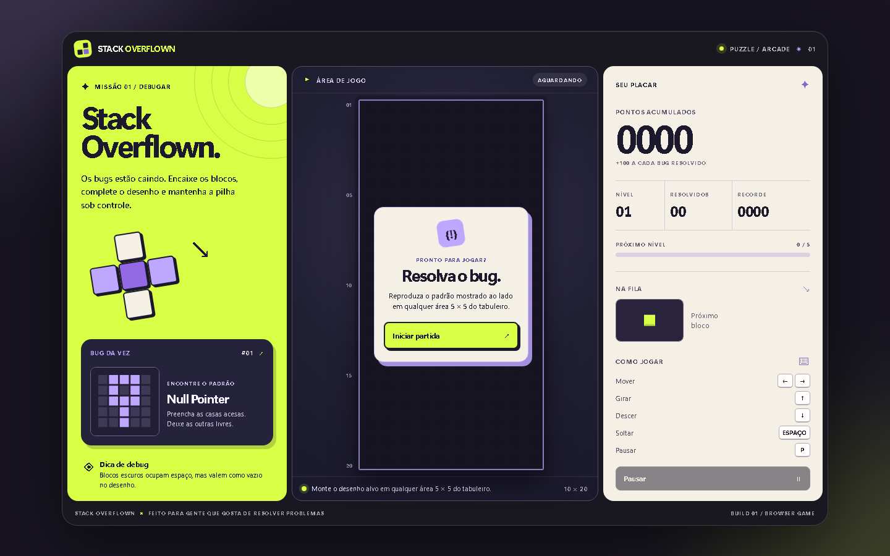

# Stack Overflown

Jogo de blocos inspirado em erros de programação. O objetivo é reproduzir o padrão 5 × 5 mostrado ao lado do tabuleiro. Cada acerto vale 100 pontos e limpa apenas a área resolvida. A velocidade aumenta a cada cinco padrões.



O alvo e o placar rápido ficam acima do tabuleiro no celular; os controles de toque permanecem acessíveis durante a partida. [Veja a prévia móvel](docs/images/mobile.png), a [auditoria visual e técnica](docs/AUDITORIA.md) e o [roadmap](docs/ROADMAP.md).

## Jogar localmente

Requer Node.js 20.19+ ou 22.12+.

```bash
npm ci
npm run dev
```

Abra o endereço mostrado no terminal. Para validar o projeto:

```bash
npm test
npm run build
npm run test:ui
```

## Controles

| Tecla | Ação |
| --- | --- |
| ← / → | Mover |
| ↑ | Girar |
| ↓ | Descer uma linha |
| Espaço | Soltar até o fundo |
| P | Pausar ou continuar |

Em telas pequenas, use os botões abaixo do tabuleiro. Blocos escuros (`void`) ocupam espaço físico, mas contam como uma célula vazia ao conferir o padrão. A sombra translúcida mostra onde a peça vai pousar.

## Estrutura

- `src/game.ts`: regras, colisões, pontuação e estado do jogo, sem acesso ao DOM.
- `src/patterns.ts`: desenhos dos bugs.
- `src/render.ts`: desenho dos canvas.
- `src/main.ts`: controles, relógio e interface.
- `tests/game.test.ts`: testes das regras principais.
- `scripts/check-ui.mjs`: teste da interface, nove tamanhos de janela e fluxos de jogo em Chromium.
- `docs/`: auditoria, roadmap e capturas.

Vite e TypeScript cuidam da compilação. O jogo publicado usa só arquivos estáticos, sem fontes ou bibliotecas visuais carregadas em tempo de execução. O recorde fica salvo no navegador com `localStorage`. Para rodar o teste de interface localmente, instale o Chromium do Playwright uma vez com `npx playwright install chromium`.

## Publicar no GitHub Pages

1. Crie um repositório vazio no GitHub, por exemplo `stack-overflown`.
2. Adicione o remoto e envie a branch `main`:

   ```bash
   git remote add origin https://github.com/SEU-USUARIO/stack-overflown.git
   git push -u origin main
   ```

3. Em **Settings → Pages → Build and deployment**, selecione **GitHub Actions**.
4. O workflow testa regras, compila, verifica a interface em Chromium e publica o conteúdo de `dist` a cada push para `main`. O endereço será `https://SEU-USUARIO.github.io/stack-overflown/`.

Os caminhos gerados são relativos, então o jogo também funciona se o repositório receber outro nome. A publicação pública ainda depende da confirmação da origem e licença do código inicial fornecido para esta adaptação.

## Histórico Git

As mensagens de commit explicam a mudança em português. Uma boa sequência para evoluir este projeto é abrir uma branch por melhoria (`feat/efeitos`, `fix/rotacao`), fazer commits pequenos, revisar o diff e integrar por pull request.
